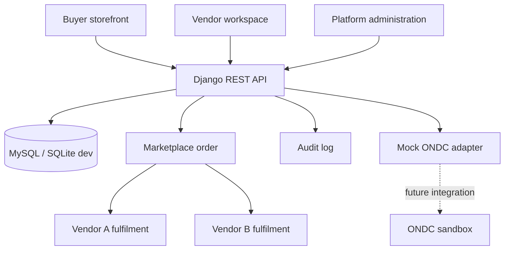

# Architecture

## Current topology

## Bounded responsibilities

- **Buyer:** owns the parent order and can view its combined items and fulfilment progress.
- **Vendor:** owns products and fulfilment records associated with its vendor profile. Fulfilment serializers filter order items by vendor; vendors cannot access another vendor's lines.
- **Platform admin:** controls vendor approval/suspension, category governance, platform order oversight, and audit review.
- **Marketplace order:** represents the buyer's overall checkout.
- **Vendor fulfilment:** represents one vendor's independent packing, shipping, tracking, and delivery lifecycle within a parent order.

## Order lifecycle

Checkout validates availability and reserves stock transactionally. Order items snapshot product names and prices. A distinct fulfilment record is created for each vendor represented in the order. Vendor status updates are scoped to the authenticated vendor and use explicit transitions. The parent order status advances only when the relevant vendor fulfilments reach matching stages.

Cancellation is allowed only before any vendor begins packing or shipping. Cancellation restores stock and marks all associated fulfilments cancelled. This avoids silently restocking items that may already be in transit.

## Security boundaries

- Public catalogue exposes only active products from approved, non-suspended vendors.
- Vendor product and fulfilment querysets are scoped to the authenticated vendor.
- Vendor APIs require an approved and active vendor profile where appropriate.
- Admin endpoints require staff privileges.
- Buyer order history is scoped to the authenticated buyer.
- Order writes and stock movements are transactional and audited.

## ONDC integration boundary

The current `/api/ondc/catalog/` endpoint is a mock catalogue mapping only. It does not communicate with ONDC. Live network participation remains a separate integration phase requiring domain/participant selection, onboarding, subscriber identity, current Beckn/ONDC message contracts, cryptographic signing/verification, callbacks, and conformance testing.
