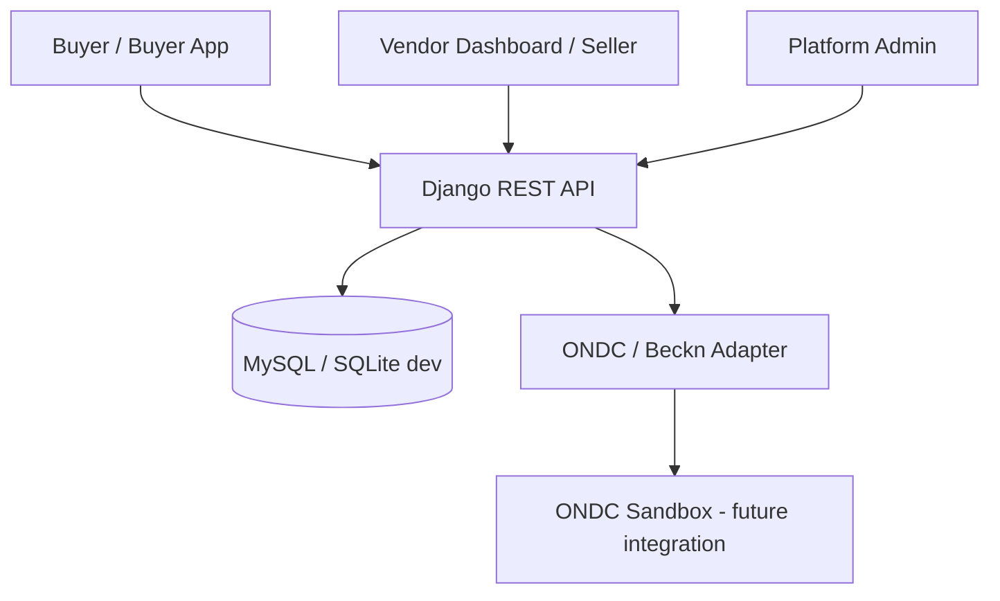

# Architecture

The current `ondc/catalog/` route is a mock catalog mapping for development. It is not a live ONDC participant integration. Production requires onboarding, domain-specific compliance, subscriber identity, signing and verification, callbacks, and conformance tests.
